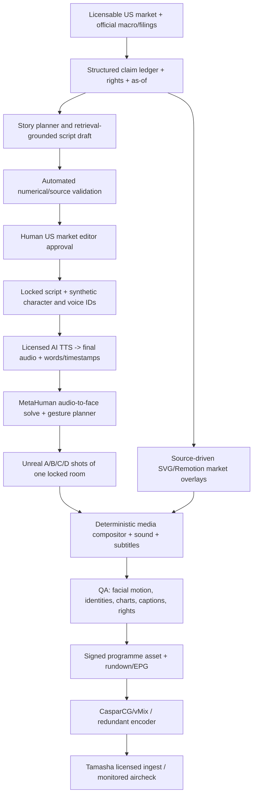

# STOCKS — AI-NATIVE Digital Television Network (Approved Production Mandate)
**14 October 2026 — supersedes all human-presenter recommendations in the earlier Network Blueprint.**  
**Status:** Engineering blueprint, not a completed character/studio/render or a transmitted channel.

## Non-negotiable editorial/creative instruction
The user explicitly requires an **AI-presented** financial television channel, with **NO real human presenter, spokesperson, representative or filmed human actor visible on-air**. The current concept art's Nora and Marcus are fictional digital personas; the visual reference is a character/art-direction target, **not an executable video, animatable mesh or performance licence**.

Behind-the-scenes editors, character artists, technical directors, fact-checkers and playout operators are permitted to build and supervise the system. Their physical likenesses, speech recordings or body-capture performances are **not used on screen** without a separate user direction (not currently authorized).

**Exclusive subject area:** U.S. stock market and U.S.-relevant macro/earnings/companies.  
**Channel identity:** one small real Tamasha T bug and Stocks / MARKETS BUSINESS PEOPLE at top-left; no huge redundant wordmark behind anchors.  
**Set look:** the second user-approved premium blue financial newsroom image (glass desk, NYC skyline, one right-market wall, comfortable head/shoulder scale, clean ticker). **Never burn AI-generated prices, LIVE badges, anchors, text, or repeated logos into the studio master.**  
**Runtime ambition:** 3–4 hours of scheduled content per day; the split of unique minutes vs replay/evergreen is an open programming choice. Design for full-new output capability by measuring render RTF (render time per output minute) before promising economics.

## Technical strategy — own the DIGITAL characters and studio
**Preferred:** Unreal Engine 5.8 + MetaHuman Creator / MetaHuman Animator audio-driven facial animation + Control Rig / Sequencer, with professionally art-directed original fictional Nora and Marcus; Unreal Movie Render Graph/Queue for recorded camera shots, and a realtime render mode as a *separate tested option* for breaking/news update inserts.

The main lesson from the earlier pilot: **stop generating a new unrelated 2D image or isolated office avatar for every shot**. We must render all presenter pixels from a single versioned character mesh, clothing/groom and 3D scene with fixed camera and light rigs.

### Four layers of on-screen image
1. **3D room asset**: one `Stocks_Newsroom` Unreal Level containing wall, architecture, generic permitted skyline, glass desk, chairs, light and reflection probes. Physical geometry does not drift across shots.
2. **3D character rigs**: two fictional, rigged, full-body digital humans. Each has a unique `character_id`, face geometry, expression controls, skin/eye materials, teeth, hair/groom, fixed wardrobe variant, seat interaction rig and approved locked synthetic voice. **No human video background exists to leak cupboards/shelves.**
3. **Performance animation**: approved AI narration audio → phonemes/audio-driven facial solve → separate curated head turn/blink/breath/eye/gaze and hand/upper-body gestures via Control Rig; deliberate **listener** state for silent actor. Hand to desk and laptop needs fixed IK targets and collision/surface constraints, not model-invented moving pixels.
4. **Broadcast overlays**: deterministic sharp graphic layers, not 3D/image-generator invented content: one small exact T + Stocks logo, name straps, right US-market panel, story chyron, progress/ticker, source/as-of and RECORDED/LIVE as verified. Use original data ledger/rights.

### Creative locking
- User-approved concept image is reference only. Reconstruct original fictional faces in a rigged system using 3D character sculpting/MetaHuman Creator; **exact photoreal likeness from a single raster picture is not a guaranteed automatic import**.
- Separate 360-degree turntables and neutral/blink/smile/phoneme tests for each digital persona. Sign off 3D neutral models from matching close and wide cameras **before** animating the 2-person scene.
- Every approved mesh/groom/wardrobe/light/camera/voice uses a cryptographic hash and version ID; never change any of these within a programme without explicit scene transition/approval.
- Do not use unapproved real-person identities, third-party presenter likenesses, existing Liza/Lasse office source files, or synthetic generated still actor pixels in the long-term channel. They are historical pilot artifacts only.

## AI editorial & speech architecture

**Only the faces and motion are synthetic. Facts cannot be.** AI text does not go directly to air. Structured numerics and broadcast rights remain editorially verified before graphic output. Live vs recorded status is controlled by the playout operator and verified source state, not the creative model.

## Character animation production spec
| Subsystem | Implementation | Acceptance test |
|---|---|---|
| Fictional Nora/MARCUS identity | Original versioned MetaHuman-compatible character rigs sculpted from approved art references | Full neutral 360° turntable, A/B/C same identities and outfits |
| Facial speech | MetaHuman Animator *offline audio-driven* from final TTS audio | Exact audio duration; no distracting lip/jaw/mouth mismatches in 90s moving QA |
| Facial micro-expression | Mood parameter + manual blink/gaze schedule (not random face regeneration) | Both speakers visibly animate in conversation; silent actor listens naturally, no frozen loops |
| Body/hand posture | Character seated poses, breathing, Control Rig and desk IK with physical contact constraints | No hands through glass desk, floating wrists or posture morphing on camera cuts |
| Virtual camera system | Fixed A wide, B Marcus, C Nora, D market charts; same engine Level/lights | Desk/window geometry consistent across A/B/C; no frame/boundary discontinuity |
| Voice | Licensed permanent synthetic voice identity per character with lexicon for tickers, Fed, CFO/company names | Stable voice across episode; no abrupt accent/timbre changes and validated timings |
| 3D rendering | Unreal Movie Render Queue/Graph on dedicated GPU workers, potentially realtime mode only after benchmarking | Output 1080p30 with consistent grade; throughput measured, not assumed |
| Graphics & audio | Deterministic overlays plus mix/loudness standards from ingest contract | Legible safe zones, source/as-of on quotes, correct labelled replay, captions/audio QA |

**Development proof policy:** Begin with a 90-second *fully digital, fully voiced* two-person scene from **one Unreal project**. It must include a seated wide shot, two single-camera turns, visible silent listener reactions, hands/desks, one graphics insert and correct source label. Evaluate whole moving video, not still mockups. Stop and fix rig before rendering 2min or hours.

## Daily 3–4h operation with purely AI presenters
- A fully synthetic **primary** network is feasible as a production objective through serialized, quality-controlled segments; it is not 4 continuous hours of stochastic image generation.
- Programme factory schedules ~3–10 minute synthetic-anchor segments, 10–30 minute chart-led explainers, topical market news, analysis shows and scheduled interviews involving original fictional AI personas.
- Fixed identity/render assets allow data and scripts to refresh without rebuilding rooms/faces.
- Distinguish **newly created** minutes and **scheduled/replayed/evergreen** minutes in the rundown. 3–4 hours/day of truly unique scenes requires measured GPU capacity, voice minutes, editorial workforce and fact licensing; don't promise it at pilot stage.
- Audio/TTS generation may be a small part of compute; 3D ray-traced render time and storage/quality checks may dominate. Benchmark per camera style and load factor before buying compute.
- Playout via one persistent GPU/control-room service with independent standby/backup, not through a per-viewer model API or Vercel function.

## Engineering phases: AI-only on-air, quality-first
**S0 — Character and scene contract (NOW):** Lock fictional cast, voice/rig requirements and studio scene IDs; record approved reference; build no-cost schemas and CI; keep market rights and TV specs gates.

**S1 — Owned character + set assets (studio TD/character artist on UE-compatible GPU):** Build the actual `.uproject` plus meshes/grooms/wardrobe and one consistent studio room; render static A/B/C outputs and neutral face-turntables. These are editable engine assets, **not a new imagegen still**.

**S2 — Motion/audio integration:** Select synthetic permanent voices and licensed TTS; produce short financial script with sourced data, offline audio-to-face solve, curated seated/body/eye/desk IK states. Render **90 seconds with two speaking characters, including listening and actual shared desk.**

**S3 — Formal creative acceptance:** Human QA assesses mouth, eyes, teeth, hands, clothing, foot/desk, camera continuity, render fidelity. Fail/retune rig until no release-blocking visual defect; no more image-to-video patchwork.

**S4 — Automated production factory:** Build versioned script/claim editor, exact audio TTS, scheduled Sequencer cameras, deterministic Remotion graphics, MRQ GPU worker, caption/technical QC, approval ledger and media versioning. First 10-minute fully synthetic original package.

**S5 — Broadcast operations:** vMix/CasparCG scheduled 30–60 minute US-market block with standby, recording and ingest QA, then extend to 120 minutes and 180–240 minutes/day with measured on-air reliability and editorial staffing.

No promise that proprietary UE project or high fidelity moving character clips have already been created. The GitHub JS/JSON contracts can be built immediately; actual UE assets need a GPU workstation with Unreal Engine, art-direction and animation work. No usage-based API jobs or provider purchases are authorized by this document.

## Minimum deliverables and ownership
- `Stocks_Broadcast.uproject`, a versioned Unreal Level, original `MH_Nora`/`MH_Marcus` rigs and clothing materials.
- `Camera_A/B/C/D` assets; one locked studio set; no source office imagery.
- Character registry (names, mesh/groom versions, voices, rig readiness and identity proof hashes), scene/shot specs, permanent prompt/face still references.
- Audio/timestamp-to-Face rig operator and gestures preset library, source-grounded graphics.
- Scalable render worker/queue and QA with exact hashes; optional burst GPU workers.
- Approved 90s two-person moving digital showcase, then 10min source-backed pilot, then 3–4h programming scheduler.
- Playout health, recordings, monitoring, standby, Tamasha spec and rights records.

## Official capability evidence
- Epic MetaHuman original character creation: https://dev.epicgames.com/documentation/en-us/metahuman/metahuman-documentation
- Epic MetaHuman audio-driven facial animation (offline + blinks/head/mood): https://dev.epicgames.com/documentation/en-us/metahuman/audio-driven-animation
- Epic MetaHuman 3D body rigs/Control Rig: https://dev.epicgames.com/documentation/en-us/metahuman/animation
- Epic Movie Render Graph/Queue scheduling and quality: https://dev.epicgames.com/documentation/unreal-engine/movie-render-pipeline-in-unreal-engine
- Epic MetaHuman identity from 3D mesh: https://dev.epicgames.com/documentation/metahuman/from-mesh
- Epic MetaHuman Python automation: https://dev.epicgames.com/documentation/en-us/metahuman/python-scripting-for-metahuman-animator

### What is explicitly out of scope
**No filmed human TV representatives, hosts, anchors or co-presenters.** Human market editors and technical operators behind-the-scenes remain because source legitimacy, legal/commercial rights and dangerous false price claims still need accountable review.
