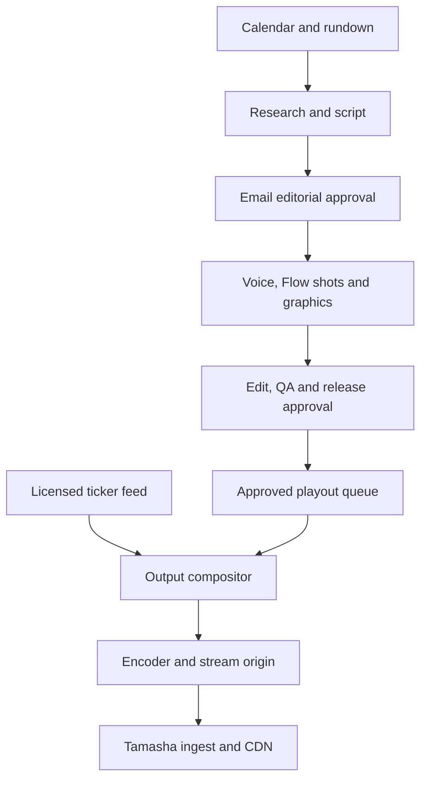

# Tamasha MarketWatch: developer handoff
Prepared 28 October 2026. This is the implementation specification and backlog, not an installed production service.

## Outcome
Stage 1: daily schedule → sourced scripts → human email review → locked voice/visual production → edited masters → human release.
Stage 2: approved playlist + live graphics → continuous encoder → streaming origin → Tamasha ingest/CDN.
90 fresh editorial minutes every calendar day; remaining airtime uses cleared repeats/filler/continuity. A 24/7 transmission is not 24/7 fresh production.

Read [Production](PRODUCTION.md), [Streaming](STREAMING.md), [Costs](COSTS.md), [Delivery and issues](DELIVERY.md).
No subscriptions, servers, paid renders, emails or broadcasts are activated by this documentation.

## Verified starting point
- main: 0796055b8c3422db493acbae19dc263e15849b8a.
- PR #65, codex/tamasha-script-approval-pilot, f07a602eea7a3b24fc5008feb69a8046bc88f626: open/unmerged at inspection. Contains pilot/script-desk/core.mjs, cli.mjs, wardrobe.mjs and tests. It handles a bounded TWO-script review; generalize it rather than pretending it already schedules the whole channel.
- Existing main pilot/production.mjs, compositor and provider modules are reuse candidates; run tests and audit capabilities before integration. Existing English two-host and Urdu one-host contracts differ.
- Existing #62 production roadmap, #64 presenter defects, #14 continuous-channel scope, #20 data graphics and #27 buffered playout remain open. New issues specify this launch implementation; they do not close historic acceptance gates.
- Existing local CLI approval records are not sufficient authentication for a public review service.
- V11 programming proposal is the latest named programming proposal in the project root inspected today. Airtimes and some slots remain proposals, not approved broadcast bookings.
- Source input: supplied “Streaming Solution (1).pdf”, two pages: PC playout + CG, H.264 1080p 4–6Mbps, RTMP/SRT, dual ISPs, online UPS, optional backup PC. Recommendation below separates control/render/playout, and favours cloud origin for continuity; PC option remains viable with measured redundancy.

## Product and assets
[Complete in-app assets](https://drive.google.com/drive/folders/1QCtPa7Rz8jI5DlNfd9EGSDe8s6JKPdfP): logo 250×250, posters 300×450 / 800×450, sliders 900×1050 / 1280×720, channel title and description.
[Project source](https://drive.google.com/drive/folders/18r-9fHbJDawwuqO7yzBjP1O9aIIEW5vW)
Use exact approved logo files; do not regenerate lettering. Poster delivery is not acceptance of a broadcast studio.

## Recommended stack
Extend Node 24 service + PostgreSQL (jobs, decisions, outbox, schedules), private S3-compatible object storage (media), FFmpeg render workers and a separate long-running playout host. Use PostgreSQL-backed job claims initially; do not add Redis/Kubernetes until throughput warrants it.
Gmail API for a dedicated review mailbox; Drive for readable review/delivery packs, not locks or transactional state.
Google Flow operator queue for selected B-roll; separately qualified supported Google video API for eventual automation.
Existing voice/avatar adapters, subject to account/voice/model verification. Deterministic charts/lower thirds/captions.
MediaMTX origin + TLS proxy; Tamasha-owned delivery/CDN preferred. OBS is an operator recovery/preview option, not the unattended scheduler.

